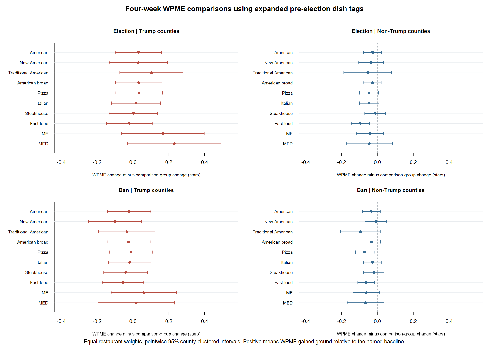

# Expanded positioning, Mediterranean group, and alternative baselines

User-selected construction: primary category; dish tags only from reviews before November 8, 2016, frozen for both shocks. Primary-ME restaurants are separate. WPME = primary Mediterranean plus a dish tag. MED = primary Mediterranean with observed pre-election text and no detected tag. Missing usable text is unknown, not MED. These are cuisine-positioning proxies, not owner nationality or authenticity measures.

The main dictionary includes a conservative named-dish core plus shared-dish terms. Core-only, pre-election baba-only, old saved baba flag, and all-saved broad tags are separate sensitivity definitions. Generic rice/pita/lamb/salad/wrap/grill words are excluded. The dictionary is English/Romanized; a mention is not a verified menu item. All-saved/legacy tags can use post-event information and are not the main specification.

## Four-week WPME results

Every restaurant gets equal weight. Each restaurant-period rating is review-count weighted; restaurants must be observed before and after. Values below are WPME change minus baseline change, with raw county-clustered p-values. Stars: * p<.10, ** p<.05, *** p<.01. Positive means WPME gained ground.

| WPME vs | Election Trump | Election non-Trump | Ban Trump | Ban non-Trump |
| --- | --- | --- | --- | --- |
| American | +0.031 (0.636) | -0.027 (0.280) | -0.020 (0.739) | -0.033 (0.190) |
| Pizza | +0.033 (0.621) | -0.048* (0.078) | -0.011 (0.857) | -0.070*** (0.009) |
| Italian | +0.017 (0.804) | -0.046* (0.096) | -0.018 (0.767) | -0.028 (0.268) |
| Steakhouse | +0.002 (0.973) | -0.013 (0.660) | -0.041 (0.511) | -0.020 (0.494) |
| Fast food | -0.020 (0.758) | -0.096*** (<.001) | -0.055 (0.351) | -0.062*** (0.009) |
| ME | +0.167 (0.153) | -0.043 (0.268) | +0.060 (0.513) | -0.061 (0.102) |
| MED | +0.231* (0.082) | -0.045 (0.494) | +0.018 (0.867) | -0.066 (0.205) |


No requested baseline gives a statistically clear four-week WPME decline in Trump counties. Election non-Trump WPME-Fast food is -0.096 stars (p=.000195; Holm across ten baselines=.00195; Holm across all 720 subgroup specifications=.140). The direct Trump-minus-non-Trump difference for that comparison is +.076 (p=.277), so subgroup significance is not evidence of different county-type effects. These are exploratory descriptive comparisons, not validated causal effects.



## Population versus event sample

Counts describe the supplied Google metadata frame, not all US restaurants. Source pools are before county/vote and event-review eligibility. WPME/MED frame counts are limited by available text from a previously food-screened corpus.

| Group | Source pool | Election Trump | Election non-Trump | Ban Trump | Ban non-Trump |
| --- | --- | --- | --- | --- | --- |
| ME | 3,227 | 101 | 1,069 | 126 | 1,195 |
| WPME | 1,719 | 183 | 1,133 | 206 | 1,207 |
| MED | 1,046 | 101 | 505 | 118 | 588 |
| MED unknown | 2,677 | Excluded | Excluded | Excluded | Excluded |
| American | 37,491 | 6,572 | 11,119 | 7,684 | 12,191 |
| Pizza | 57,544 | 6,270 | 13,385 | 8,229 | 15,998 |
| Italian | 19,273 | 2,576 | 6,786 | 3,077 | 7,881 |
| Steakhouse | 7,592 | 1,862 | 2,760 | 2,124 | 3,013 |
| Fast food | 60,392 | 14,384 | 20,137 | 17,367 | 22,723 |


There are 5,442 primary-Mediterranean businesses: 1,719 broad pre-tag WPME, 1,046 MED/no detected tag, and 2,677 unknown. Only 2,765 have usable pre-election text in the saved July 2016-June 2017 corpus. Pre-election baba alone tags 113; the conservative core tags 661. More raw pre-election review coverage and validation are needed before describing the MED group as truly serving no ME dishes.

ME uses the fixed primary-category list in config.json, now applied to the full metadata without the old food-mention screen. Its 3,227 businesses include Middle Eastern (1,098), Halal (775), Lebanese (458), Persian (360), Afghani (227), Moroccan (120), Armenian (45), Kebab shop (41), Egyptian (33), Yemenite (32), Syrian (29), North African (6), and Shawarma (3). Halal and generic labels are not nationality-specific. Iraqi, Palestinian, Jordanian and several Gulf-country labels are allowed but absent as primary labels in this frame; Turkish, Israeli and Greek are not explicit ME-list entries. WPME secondary labels include Greek, Turkish, Lebanese and Persian, among others, and overlap.

## Updated ME finding

Full-metadata sampling retains all original 92 Trump ME election restaurants and adds nine, taking N to 101. The original 92 have average change -.205; additions average +.866. American controls expand from 3,001 to 6,572. ME-American becomes -.136 (p=.164), versus -.249 (p=.008) previously. The direct county difference becomes -.152 (p=.142), versus -.217 (p=.031). These are sample-definition sensitivities, not pre-trend corrections. The previous results remain preserved.

## Full report, data and rerun

Download and extract [expanded_positioning_analysis.zip](expanded_positioning_analysis.zip), then open analysis_clean/expanded_positioning/expanded_positioning_report.html. Its selectors expose all five dictionary/timing definitions and all 4-, 6- and 10-week windows for both shocks and county groups. It includes direct county tests, population/sample counts, category composition and 72 longer-history pre-trend checks.

From the extracted directory:

```sh
python -m pip install -r analysis_clean/requirements.txt
Rscript analysis_clean/install_dependencies.R
python analysis_clean/materialize_expanded_inputs.py
Rscript --vanilla analysis_clean/expanded_positioning_models.R
python analysis_clean/verify_expanded_positioning.py
Rscript --vanilla analysis_clean/plot_expanded_positioning.R
python analysis_clean/report_expanded_positioning.py
```

The aggregate weekly inputs and losslessly compacted group assignments are included; materialize_expanded_inputs.py reconstructs the exact original assignment bytes. Models regenerate the six restaurant-period tables. No original Dropbox access is required to rerun models, independent verification, plots or report. Rebuilding metadata geography and review tags requires original source files. Review text and reviewer names are excluded from the archive; the local context audit stays local. MANIFEST.json records archive member hashes. Independent NumPy checks verify all six period constructions, 720 subgroup estimates/SEs, 360 direct estimates/SEs, and 72 pre-trend statistics (maximum error <2e-14). R/model versions are in expanded_R_session.txt.
