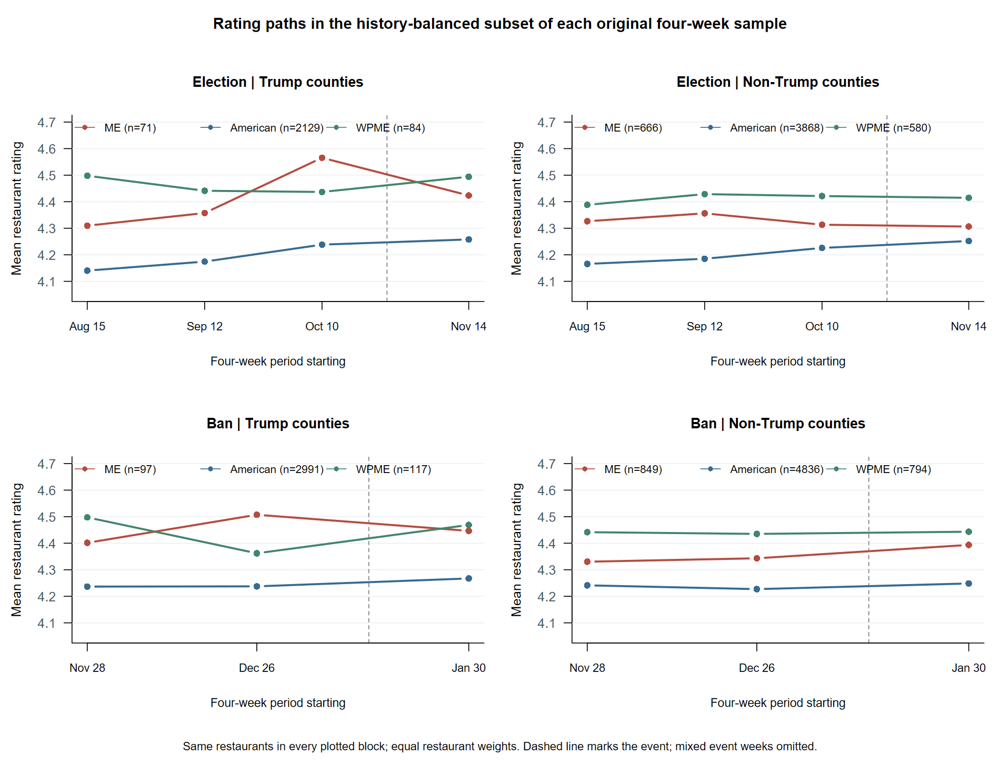
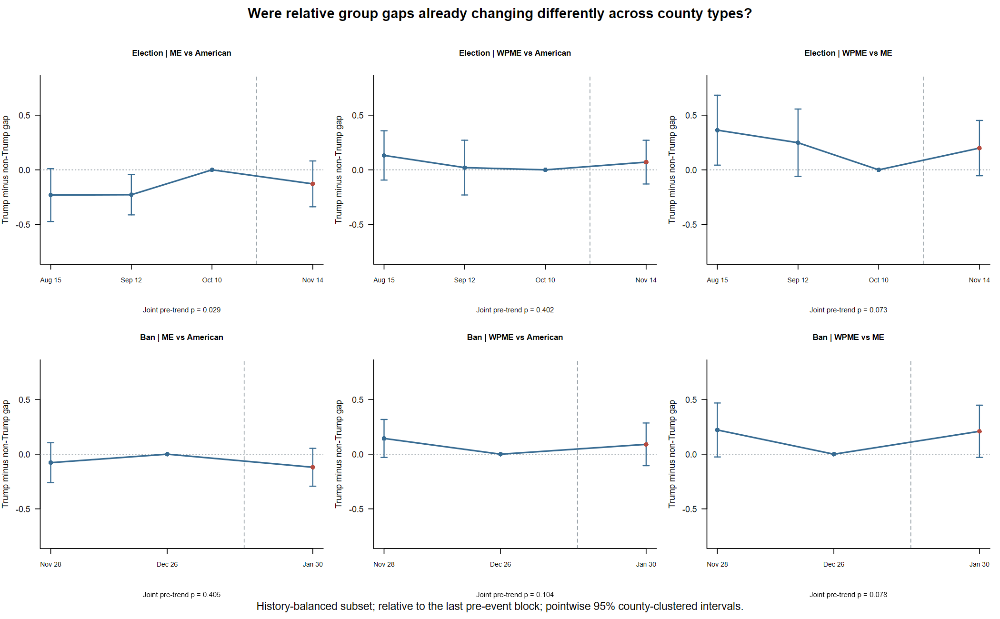

# Four-week sample pre-trend diagnostics

These checks do not validate a causal election effect. The weekly tests use the original four-week cohorts, with restaurants having at least two pre-event weeks. None rejects at 10%. Longer-history plots use fixed subsets observed in every four-week block: election ME counts are 71 Trump / 666 non-Trump, versus 92 / 874 originally; ban counts are 97 / 849 versus 116 / 968 originally.

The longer-history election ME-American gap changes differently across county types (joint p=.029 unadjusted, .523 after Holm across 18 history tests). Trump ME ratings rise before the election then partially fall back. In this history-balanced subset the election ME-American post contrast is -.162 (p=.103) in Trump counties, and the direct county-type difference is -.128 (p=.230). Changing the sample is not a pre-trend correction. The ban WPME-ME pre-trend in Trump counties has p=.042 unadjusted, .713 adjusted. Non-rejection elsewhere is not proof of parallel trends.

The plots below use equal restaurant weights. Error bars in the gap figure are pointwise 95% county-clustered intervals, relative to the last pre-event block.




## Download the full analysis

Download and extract [pretrend_analysis.zip](pretrend_analysis.zip), then open analysis_clean/outputs/four_week_pretrend_report.html. It includes all six PNG/SVG figures, every test and sample count, causal interpretation, and sample-expansion audit. It contains the aggregate weekly history needed to rerun estimation; raw review text is excluded.

From the extracted folder:

```sh
python -m pip install -r analysis_clean/requirements.txt
Rscript analysis_clean/install_dependencies.R
Rscript --vanilla analysis_clean/test_four_week_pretrends.R
python analysis_clean/verify_pretrends.py
Rscript --vanilla analysis_clean/plot_pretrends.R
python analysis_clean/report_pretrends.py
```

Requires Python and R, with the same dependencies as the main repository. The archive preserves original folder structure; source preparation and master-audit scripts require original local project files, but estimation, verification, plots and report run entirely from packaged inputs. File hashes are in MANIFEST.json. Independent NumPy checks reproduce all 30 joint tests and 18 history post contrasts.

## Sample expansion

The existing Trump ME pool has 165 businesses, of which only 92 have reviews both sides of the election's four-week window. Six-week windows retain 106; ten weeks retain 128, but change timing/cohort and already weaken the estimated election contrast. The upstream cuisine universe was selected using food mentions. Rebuilding eligibility from full metadata without that screen is the highest-value expansion audit; gains are unknown. The broader saved master has 593 extra primary-ME IDs, but 591 have no review in the saved July 2016-June 2017 panel, so these cannot be treated as 593 usable additions.

Methodological reference: [Roth, Pretest with Caution](https://pubs.aeaweb.org/doi/10.1257/aeri.20210236). These diagnostics are exploratory and do not establish identification.
