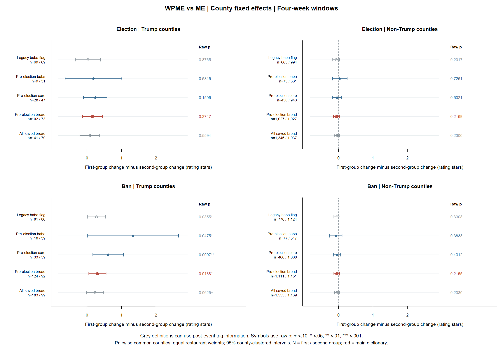

# Four-week regressions and dictionary sensitivity

Holm is a multiple-testing adjustment to p-values. It does not change a coefficient, standard error or regression. The tables below emphasize raw two-sided p-values, with corrections separate. New symbols: + p<.10; * p<.05; ** p<.01; *** p<.001.

## Approved specification

Each restaurant contributes one review-count-weighted pre-period rating and one post-period rating, then a rating change. Every restaurant gets unit regression weight. Main pairwise model: change = county fixed effects + first-group indicator. Standard errors cluster by county; CR1 corrections use fixest's nonnested FE convention and t tests use counties minus one degrees of freedom. Only counties with both groups identify the comparison. This is point-estimate-equivalent to restaurant FE plus county-by-period FE in a two-period panel.

We retain three specifications to separate sample restriction from adjustment: original raw change; raw change restricted to shared counties; county FE on those same shared counties. An additional joint model includes WPME and MED indicators (ME reference) and restricts to counties containing all three groups.

Main broad pre-election dictionary, pairwise county-FE regressions:

| Contrast | Election Trump | Election non-Trump | Ban Trump | Ban non-Trump |
| --- | --- | --- | --- | --- |
| WPME vs ME | +0.159 (p=0.2747) | -0.055 (p=0.2169) | +0.303* (p=0.0188) | -0.051 (p=0.2155) |
| WPME vs MED | +0.161 (p=0.3061) | -0.054 (p=0.4822) | +0.061 (p=0.6664) | -0.024 (p=0.6644) |
| ME vs MED | -0.027 (p=0.8926) | -0.050 (p=0.5170) | -0.144 (p=0.3438) | +0.026 (p=0.6630) |


For the ban in Trump counties, WPME-ME changes from +.060 (p=.513) originally to +.220 (p=.026) on shared counties and +.303 (SE=.123; p=.0188) after county adjustment on those same 216 restaurants (124 WPME, 92 ME; 38 counties). Holm across three pairs gives p=.0564. Thus changing the geographic sample matters.

The three-group common-county model estimates ban Trump WPME-ME at +.417 (SE=.124; p=.00287; three-contrast Holm=.00861), using 217 restaurants (95 WPME, 69 ME, 53 MED) in 23 counties. Its direct Trump-minus-non-Trump contrast is +.468 (p=.000386). This uses a smaller, different geographic sample and is an additional specification, not a replacement chosen for significance. No election comparison is statistically clear.

Pre-trend diagnostics use smaller history-balanced subsets. Ban WPME-ME direct county-type pre-trend p-values are .076 in the pairwise model and .060 in the joint model. These do not survive broad pretest adjustment; non-rejection is not proof of parallel trends. The current estimates are not established causal effects.

## Reports and plots

Download and extract [four_week_regressions.zip](four_week_regressions.zip) into its own directory, then open:

- analysis_clean/county_fe_regressions/regression_report.html: coefficients, SEs, raw p-values, adjusted p-values, sample/common-support counts, joint regressions and dictionary-sensitivity plots.
- analysis_clean/dictionary_focus/dictionary_focus_report.html: the original no-county-FE sensitivity plots and a worked explanation of p=.0823.



All three pairwise plots and joint-model sensitivities are in the report. Grey dictionary definitions can use post-event information. The main tags use primary categories and only pre-election reviews, frozen for both shocks. The dictionary sensitivity changes group membership; it is not a change of numerical scoring on identical cohorts.

## Raw-data clarification

The current outcome pipeline uses full metadata and combined weekly Google outcomes. The current dish tags still come from the saved July 2016-June 2017 review panel. Raw state JSON/GZ files exist in the user's data folder, but no full raw-text retagging was performed in this step. The earlier unknown-tag count describes the processing subset, not proof that the raw reviews are absent. Goog_Rev_2016_2017.dta has 23,041,783 business-week rows and no review-text column. A bounded metadata inventory is included; it is not a complete coverage audit.

## Rerun

Requires Python (pandas, NumPy) and R (fixest, data.table, jsonlite).

```sh
python -m pip install -r analysis_clean/requirements.txt
Rscript analysis_clean/install_dependencies.R
```

Then run analysis_clean/run_regression_bundle.ps1 (or execute its listed commands in order). The archive includes a small, self-contained snapshot of only the focal groups in county_fe_regressions/inputs. No raw-data-folder access is needed to reproduce regressions, verification, plots or reports. Original raw-data inventory code is provided but should not be rerun unless those original files are available. All code uses the compact focal inputs when present, otherwise the prior full expanded inputs.

Independent NumPy checks reproduce 240 pairwise/sample-specification regressions, 90 joint-model contrasts, and 36 pre-trend statistics. Twelve main pairwise panel models verify first-difference/restaurant-FE equivalence. All 60 original focal p-values and confidence intervals were recomputed. MANIFEST.json records archive hashes. No reviewer names or review text are included.
